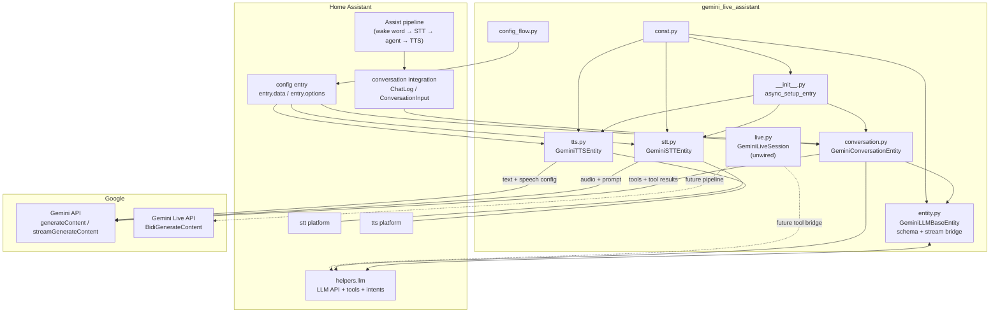
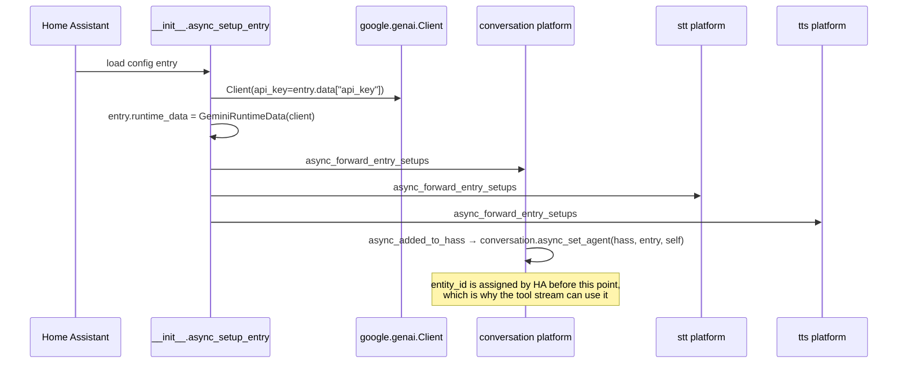
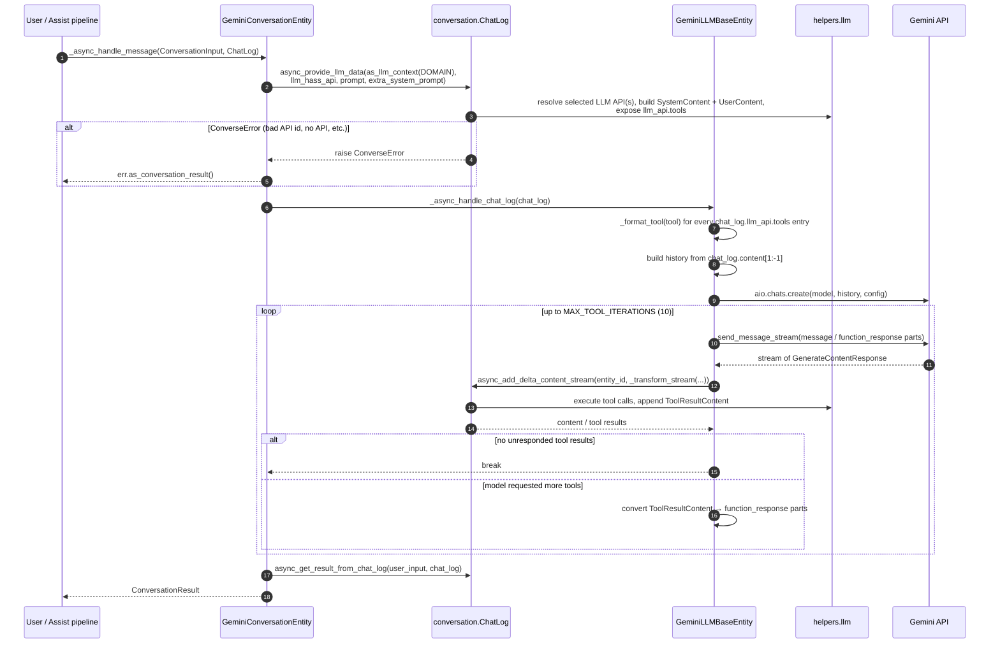

# Architecture

The integration is a thin, stateless adapter between three Home Assistant platform APIs
(`conversation`, `stt`, `tts`) and the Google Gen AI SDK (`google.genai`). There is no
coordinator, no cache, no database and no background task. Every request opens its own Gemini
call and returns.

## Component diagram



Solid arrows are live code paths. Dashed arrows exist in `live.py` as a client API but are not
invoked by any Home Assistant platform.

## Module responsibilities

| File | Responsibility | Key symbols |
|---|---|---|
| `__init__.py` | Create one `google.genai.Client` per config entry, stash it in `entry.runtime_data`, forward platform setup. | `GeminiRuntimeData`, `GeminiConfigEntry`, `PLATFORMS`, `async_setup_entry`, `async_unload_entry` |
| `const.py` | Single source of truth for the domain, config keys, model lists, voice list and defaults. | `DOMAIN`, `CONF_*`, `CHAT_MODELS`, `TTS_MODELS`, `LIVE_MODELS`, `VOICES`, `RECOMMENDED_*`, `MAX_TOOL_ITERATIONS`, `TIMEOUT_MILLIS` |
| `entity.py` | Everything that translates between Home Assistant's `ChatLog`/`llm.Tool` world and `google.genai` types: JSON-Schema sanitising, message conversion, stream normalisation, the iterative tool loop, and `GenerateContentConfig` construction. | `GeminiLLMBaseEntity`, `_format_tool`, `_format_schema`, `_convert_content`, `_transform_stream`, `_async_handle_chat_log` |
| `conversation.py` | The Assist agent entity: registers/unregisters itself as agent for the entry, fills the `ChatLog` with LLM data, delegates generation to the base class, returns the HA result. | `GeminiConversationEntity` |
| `stt.py` | Buffers an audio stream, converts PCM to WAV when needed, sends audio + fixed transcription prompt to Gemini, returns text. | `GeminiSTTEntity`, `_pcm_to_wav` |
| `tts.py` | Sends text to a Gemini TTS model with a prebuilt voice, extracts inline PCM audio, wraps it in a WAV container. | `GeminiTTSEntity`, `_pcm_to_wav` |
| `live.py` | Async client wrapper around `client.aio.live.connect`: config building, event normalisation, send/receive helpers. Not imported by any platform. | `LiveConfig`, `LiveEvent`, `LiveToolCall`, `LiveToolResponse`, `GeminiLiveSession`, `connect` |
| `config_flow.py` | API-key onboarding with live validation, plus the options form for models/prompt/control/voice. | `GeminiLiveAssistantConfigFlow`, `GeminiLiveAssistantOptionsFlow` |
| `strings.json` / `translations/*.json` | UI labels, error messages, entity names. English and Ukrainian are shipped. | — |

### Why the LLM plumbing lives in `entity.py`

`conversation.py` only has to implement `_async_handle_message`. All of the awkward parts — the
fact that HA tools are Pydantic models, that Gemini wants an OpenAPI-ish `Schema`, that HA's
`ChatLog` stores tool results as separate entries, that tool results must become **user-role**
`function_response` parts — are isolated in a single module. `stt.py` and `tts.py` do **not**
inherit from `GeminiLLMBaseEntity`; they only share the `Client` and the `const` defaults.

## Startup



Important properties:

- **One `Client` per entry.** Conversation, STT and TTS all read `entry.runtime_data.client`, so
  they share connection pooling inside the SDK.
- **No validation or network call at setup.** A bad/revoked key surfaces on first use or during a
  reconfigure, not at startup. (The config flow does validate on creation.)
- **Unload is platform unload only.** `async_unload_entry` returns
  `hass.config_entries.async_unload_platforms(entry, PLATFORMS)`; the conversation entity's
  `async_will_remove_from_hass` unregisters the agent.
- **`PLATFORMS` excludes `live`.** Realtime audio has no entity/service yet.

## Conversation request flow



### Step 1 — `async_provide_llm_data`

`conversation.py` merges `entry.data` and `entry.options` on **every** message, then calls:

```python
await chat_log.async_provide_llm_data(
    user_input.as_llm_context(DOMAIN),  # LLMContext: platform, context, language, device_id
    options.get(CONF_LLM_HASS_API),  # list[str] | None
    options.get(CONF_PROMPT),  # system prompt
    user_input.extra_system_prompt,  # pipeline/frontend addition
)
```

This is the contract that makes Home Assistant own tool execution. Consequences:

- The first `ChatLog` entry is always a `SystemContent`. `entity.py` asserts this and uses it as
  `config.system_instruction`.
- `chat_log.llm_api` is `None` when no LLM API is selected; in that case `tools` stays `None` and
  Gemini is a pure chat model.
- A `ConverseError` is returned to the caller as a normal conversation result rather than raising
  out of the entity method.

### Step 2 — history conversion

`_async_handle_chat_log` walks `chat_log.content[1:-1]`:

| ChatLog role | Converted to |
|---|---|
| `user` | `Content(role="user", parts=[Part.from_text(...)])` |
| `assistant` | `Content(role="model", parts=[text?, function_call...])` |
| `tool_result` | Collected, then emitted as `Content(role="user", parts=[Part.from_function_response(...)])` |
| `system` (only index 0) | `config.system_instruction` (not part of history) |

Two anti-fragility measures are worth knowing:

1. Empty assistant turns are kept as empty text parts so that turn alternation is not broken.
2. If history would start with a non-`user` turn, a placeholder user turn containing a single
   space is inserted. Gemini rejects histories that start with a model turn.

The current user message is `chat_log.content[-1]` and is sent separately as `chat_request`.

### Step 3 — the tool loop

```mermaid
flowchart TD
    A["history + system_instruction + tools"] --> B["send_message_stream(chat_request)"]
    B --> C["_transform_stream: normalise parts"]
    C -->|{"role": "assistant"} once| D["ChatLog.async_add_delta_content_stream"]
    D --> E{"unresponded_tool_results?"}
    E -->|no| F["done → ConversationResult"]
    E -->|yes| G["collect ToolResultContent"]
    G --> H["Part.from_function_response({data, error})"]
    H --> B
    E -->|"iteration == 10"| F
```

- Tool calls are **never executed by this integration**. `async_add_delta_content_stream` hands
  them to the HA LLM layer, which validates arguments, requires user/agent permission as
  configured, calls the intent, and appends a `ToolResultContent`.
- Both success and failure are sent back to the model: each response part carries
  `{"data": <result.data>, "error": <result.error>}`. The model is expected to phrase the failure
  for the user. Tool errors do **not** raise to Home Assistant.
- `MAX_TOOL_ITERATIONS` (10) is a hard stop against runaway tool loops. Hitting it returns
  whatever the model produced last, without an explicit error.
- `automatic_function_calling` is explicitly **disabled** in the `GenerateContentConfig`; the SDK
  must not try to call Python functions by itself. The loop above is the only execution path.

### Step 4 — result

`conversation.async_get_result_from_chat_log(user_input, chat_log)` builds the
`ConversationResult` from the now-complete `ChatLog`. Because
`_attr_supports_streaming = True`, the deltas already reached the pipeline; the final result is
assembled from the same log.

## Stream normalisation

`_transform_stream` is the adapter between `GenerateContentResponse` and
`conversation.AssistantContentDeltaDict`:

| Gemini part | Emitted delta |
|---|---|
| first candidate seen | `{"role": "assistant"}` (exactly once per stream) |
| `part.text` and not `part.thought` | `{"content": part.text}` |
| `part.function_call` | `{"tool_calls": [llm.ToolInput(tool_name, tool_args)]}` |

Thought parts are suppressed so reasoning summaries never reach the user. Empty responses
(`response.candidates` falsy) are skipped. Parts without text or a function call produce no delta.

`_escape_decode` runs over tool arguments before they are handed to HA. This compensates for
double-escaped strings (e.g. literal `\n` sequences) that can appear in model output, and it
recurses through lists and dicts. `_validate_tool_results` performs the reverse guard on the way
back: any non-JSON-primitive value in a tool result is stringified, so the SDK cannot fail to
serialise a custom object.

## Tool schema conversion

Home Assistant tools are Pydantic models, so their schema is produced by
`probatio.to_openapi(tool.parameters, custom_serializer=...)` and then normalised for Gemini:

| Step | Behaviour |
|---|---|
| Key casing | `camelCase` / `PascalCase` → `snake_case` (`_camel_to_snake`) |
| Whitelist | Only `SUPPORTED_SCHEMA_KEYS` survive: `type`, `format`, `description`, `nullable`, `enum`, `max_items`, `min_items`, `properties`, `required`, `items` |
| `type` | Uppercased (`string` → `STRING`) |
| `format` | Dropped unless sensible for the type: `enum`/`date-time` for strings, `float`/`double` for numbers, `int32`/`int64` for integers |
| `allOf` | Collapsed to the first subschema that has a `type`, else the first subschema |
| `enum` | If the type is not `STRING`, the type is forced to `STRING` and every enum value is stringified |
| Empty object | Given a placeholder `json: STRING` property so Gemini accepts it |
| Tool | Wrapped as `Tool(function_declarations=[FunctionDeclaration(name, description, parameters)])` |

If a tool has no parameter schema, `parameters=None` is sent. The tool's description is passed
through unchanged — this is why the selected Assist API's tool descriptions matter for quality.

## State, concurrency and lifetime

| Aspect | Behaviour |
|---|---|
| Conversation state | Lives only in the `ChatLog` supplied per request. The integration keeps none. |
| Cross-turn memory | Provided by the Assist pipeline's `ChatLog` continuation, not by this code. |
| Client lifetime | One `Client` per config entry, created at setup, never explicitly closed. |
| Parallel requests | Safe at the object level: no mutable per-request state on the entity. Rate limits are Google's problem. |
| Polling | None. `iot_class: cloud_polling` is a manifest label, not a behaviour; requests are user-triggered. |
| Timeout | `TIMEOUT_MILLIS = 15000` is defined in `const.py` but **not used anywhere**. The SDK's own HTTP timeouts apply. |
| Options changes | Conversation reads options per message (effective immediately). STT/TTS cache model and voice in `__init__` (need a reload). See [04-configuration.md](04-configuration.md). |

## Design decisions and trade-offs

| Decision | Rationale | Cost |
|---|---|---|
| Delegate tools to HA instead of implementing services | Works with every exposed entity, respects HA permissions/exposure, no per-domain code | Latency (one round trip per tool), depends on HA tool descriptions |
| Disable SDK automatic function calling | HA must execute tools so that auth, exposure and auditing apply | Manual multi-iteration loop to maintain |
| One shared `entity.py` for conversation only | Avoids coupling audio platforms to chat internals | Some duplication of `options = {**entry.data, **entry.options}` |
| Chat history rebuilt from `ChatLog` each turn | Stateless, restart-safe, consistent with HA's model | Re-serialising history on every request; no server-side chat session reuse |
| No `entry.add_update_listener` | Simple first version | STT/TTS model changes need a manual reload |
| Keep `live.py` isolated | Lets the realtime client evolve independently of the stable text path | The option keys `enable_live`/`live_model`/`live_voice` currently have no effect |
| `unique_id` = last 8 characters of the key | Cheap duplicate detection without hashing the secret | Leaks 8 key characters into config-entry metadata (see [08-security.md](08-security.md)) |

## Known architectural gaps

1. **`live.py` is dead code at runtime.** No platform imports it; there is no entity, service or
   websocket command. This is documented and intentional for `0.1.0` — see
   [05-live-mode.md](05-live-mode.md).
2. **No reload on options update.** Only the conversation agent sees new options immediately.
3. **`TIMEOUT_MILLIS` and `DEFAULT_TITLE` are unused.** The config flow hardcodes the title string.
4. **No diagnostics platform**, therefore no redaction pipeline.
5. **Error surface is coarse.** Any `APIError`, `ClientError` or `ValueError` during streaming
   becomes the single message `"Sorry, I had a problem getting a response from Gemini."`; the
   underlying detail is only in logs.
6. **`iot_class` is misleading.** `cloud_polling` implies periodic polling; `cloud_push` or
   `local_polling` would describe the behaviour better. Cosmetic, but relevant to HACS/quality
   scale reviews.
