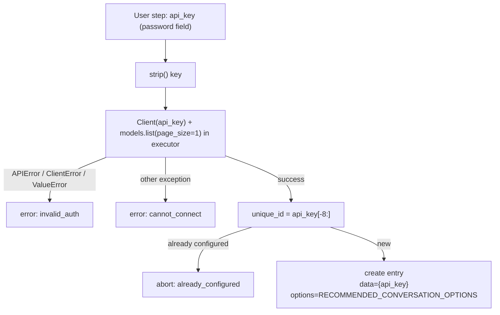

# Configuration

Everything is configured through Home Assistant's UI. There is **no YAML setup** and no
`configuration.yaml` schema: the integration is `config_flow: true` and stores a single config
entry per API key.

## Adding the integration

1. **Settings → Devices & Services → Add Integration**.
2. Search for **Gemini Live Assistant**.
3. Paste a Gemini API key from <https://aistudio.google.com/apikey>.
4. Submit. The flow performs a live `models.list(page_size=1)` call.
5. On success the entry is created with title **Gemini Live Assistant** and the recommended
   options pre-populated.



### Error and abort reasons

| Reason | Meaning |
|---|---|
| `invalid_auth` | The key was rejected or the client could not be constructed |
| `cannot_connect` | Network/DNS/TLS failure or an unexpected SDK error |
| `already_configured` | The last 8 characters of this key match an existing entry |

`strings.json` also defines an `unknown` error string, but the flow never emits it — unexpected
errors are mapped to `cannot_connect`.

### The API key cannot be edited

The key lives in `entry.data`, and the options flow does not expose it. To use a different key:

1. Delete the existing entry (this also removes its entities).
2. Add the integration again.

There is no reauth flow (`async_step_reauth` is not implemented), so a revoked or rotated key is
not detected proactively — you will only see request failures in the log.

## Options flow

**Settings → Devices & Services → Gemini Live Assistant → Configure** opens a single `init` step.
All fields are optional in the schema and pre-filled from
`{**entry.data, **entry.options}`, so saving always writes a complete options dict.

| Option | Key | UI type | Default | Validation |
|---|---|---|---|---|
| Chat model | `chat_model` | Dropdown + custom value (`CHAT_MODELS`) | `models/gemini-3.1-flash-lite` | Free text allowed |
| System prompt | `prompt` | Multiline text | `llm.DEFAULT_INSTRUCTIONS_PROMPT` | None |
| Home Assistant control APIs | `llm_hass_api` | Multi-select dropdown of `llm.async_get_apis()` | `["assist"]` | None |
| Temperature | `temperature` | Number | `1.0` | float, `0.0–2.0` |
| Maximum output tokens | `max_tokens` | Number | `3000` | int, `64–32000` |
| Enable Gemini Live module | `enable_live` | Boolean | `false` | Stored only — **no runtime effect** |
| Live model | `live_model` | Dropdown + custom value (`LIVE_MODELS`) | `models/gemini-3.1-flash-live-preview` | Stored only |
| Live voice | `live_voice` | Dropdown (`VOICES`) | `Puck` | Stored only |
| Speech-to-text model | `stt_model` | Dropdown + custom value (`CHAT_MODELS`) | `models/gemini-3.1-flash-lite` | Free text allowed |
| Text-to-speech model | `tts_model` | Dropdown + custom value (`TTS_MODELS`) | `models/gemini-3.1-flash-tts-preview` | Free text allowed |
| TTS voice | `tts_voice` | Dropdown (`VOICES`) | `Puck` | Fixed list |

### Voices

`VOICES` in `const.py`:

```
Puck, Charon, Kore, Fenrir, Aoede, Leda, Orus, Zephyr
```

The voice selector has `custom_value` **disabled**, so only these eight are selectable from the
UI, even if the model supports more. To use another prebuilt voice you must edit `const.py`.

### Defaults on first creation

`RECOMMENDED_CONVERSATION_OPTIONS` is written verbatim into `entry.options`:

```python
{
    CONF_PROMPT: llm.DEFAULT_INSTRUCTIONS_PROMPT,
    CONF_LLM_HASS_API: [llm.LLM_API_ASSIST],
    CONF_CHAT_MODEL: "models/gemini-3.1-flash-lite",
    CONF_TEMPERATURE: 1.0,
    CONF_MAX_TOKENS: 3000,
    CONF_ENABLE_LIVE: False,
    CONF_LIVE_MODEL: "models/gemini-3.1-flash-live-preview",
    CONF_LIVE_VOICE: "Puck",
}
```

Note what is **not** in the defaults: `stt_model`, `tts_model`, `tts_voice`. Those fall back at
entity construction to `RECOMMENDED_STT_MODEL`, `RECOMMENDED_TTS_MODEL` and `"Puck"` respectively,
and appear in the options form with those defaults the first time you open it.

### How options are merged

Every consumer does:

```python
options = {**entry.data, **entry.options}
```

So `entry.options` wins, and `entry.data["api_key"]` remains available to the setup code. The
options dict is not nested and has no version migration (`VERSION = 1` in the config flow).

## When changes take effect

This is the most common source of confusion, because there is **no
`entry.add_update_listener`** registered anywhere.

| Change | Effect |
|---|---|
| Chat model, prompt, temperature, max tokens, LLM APIs | **Immediate** — `conversation.py` re-merges `entry.data`/`entry.options` on every `_async_handle_message` |
| STT model | **Requires reload** — `GeminiSTTEntity.__init__` caches `self._model` |
| TTS model, TTS voice | **Requires reload** — cached in `GeminiTTSEntity.__init__` (a pipeline can still override the voice per call via the `voice` option) |
| Live options | No effect at all; `live.py` is not instantiated by the integration |
| Device "model" label | Fixed at entity construction from the chat model string |

To apply STT/TTS changes: **Settings → Devices & Services → Gemini Live Assistant → ⋮ →
Reload**, or restart Home Assistant. Reloading is cheap: no network call is made at setup.

> **Planned:** register an update listener that reloads the entry when options change, so all
> platforms pick up new values automatically.

## Selecting the agent in Assist

Options alone do not route voice traffic. After configuring:

1. **Settings → Voice assistants → Add assistant** (or edit an existing one).
2. Set **Conversation agent** to the Gemini agent (named after the config entry title).
3. Set **Speech-to-text** to `Gemini STT`.
4. Set **Text-to-speech** to `Gemini TTS`.
5. Pick a wake word if you want hands-free operation.
6. Save, then test with the **Assist** dialog or a satellite.

The integration registers its agent in `async_added_to_hass` via
`conversation.async_set_agent(hass, entry, self)` and unregisters it on removal, so the agent
appears automatically as soon as the entry is loaded. `supported_languages` is `"*"` (all
languages).

## Multiple config entries

Technically allowed: `unique_id` only blocks the same key twice, so two different keys create two
entries.

Not recommended, because:

- Both entries register conversation agents with the same title.
- STT and TTS entities use the same explicit names (`Gemini STT`, `Gemini TTS`), producing
  duplicate-looking entities.
- An Assist assistant can only bind to one agent, STT and TTS entity, so the second entry mostly
  adds clutter.

Use a single entry with one key.

## Removing

Deleting the entry unloads all three platforms and removes the entities. The API key disappears
from `.storage/core.config_entries` with the entry. Nothing is written elsewhere. Revoke the key in
Google AI Studio if it may have been exposed.

## Entity naming and translations

- Conversation entity name: the config entry title (`Gemini Live Assistant`).
- STT entity name: `Gemini STT` (`_attr_name`, `_attr_has_entity_name = False`).
- TTS entity name: `Gemini TTS` (same pattern).
- `strings.json` / `translations/*.json` contain `entity.conversation|stt|tts` name blocks, but
  because the entities set explicit names and no `translation_key`, those entity translations are
  currently unused. UI translations for the config and options flows **are** used.
- English (`translations/en.json`) and Ukrainian (`translations/uk.json`) are shipped; anything
  else falls back to English.

## Configuration checklist

- [ ] API key created in Google AI Studio and pasted into the integration.
- [ ] `llm_hass_api` contains `assist` (or another API you trust with device control).
- [ ] Entities you want controlled are exposed in **Settings → Voice assistants → Expose**.
- [ ] Conversation agent selected in the assistant.
- [ ] `Gemini STT` / `Gemini TTS` selected if you use voice.
- [ ] Integration reloaded after changing STT/TTS models or voices.
- [ ] Prompt reviewed for tone and verbosity (not for tool rules).
