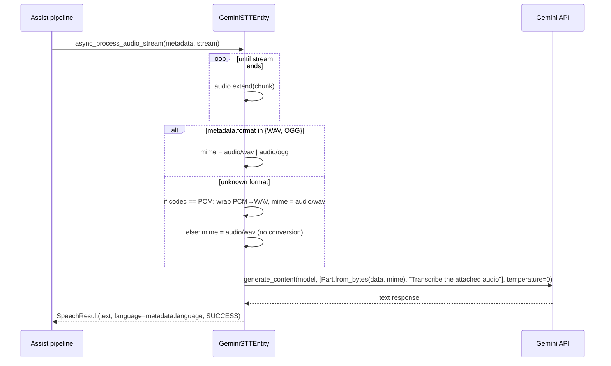
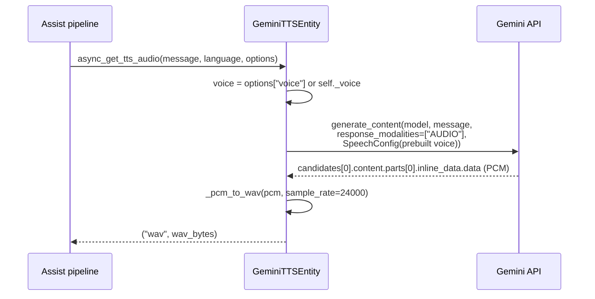
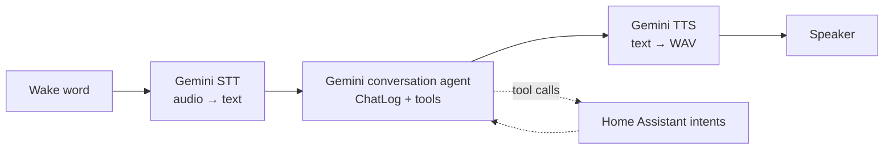

# Speech-to-Text and Text-to-Speech

Two independent platform entities provide voice support inside a standard Assist pipeline:

| Entity | Platform | Implementation |
|---|---|---|
| `Gemini STT` | `stt.SpeechToTextEntity` | One multimodal `generateContent` call with audio + a fixed prompt |
| `Gemini TTS` | `tts.TextToSpeechEntity` | One `generateContent` call with `response_modalities=["AUDIO"]`, PCM wrapped into WAV |

Neither entity uses the Live API, neither streams audio, and neither shares code with
`entity.py` beyond the `Client` and constants.

## Speech-to-text (`stt.py`)

### Capabilities

| Property | Value |
|---|---|
| `supported_languages` | `"*"` (all) |
| `supported_formats` | `WAV`, `OGG` |
| `supported_codecs` | `PCM`, `OPUS` |
| `supported_bit_rates` | `BITRATE_16` (16-bit) |
| `supported_sample_rates` | 16 000, 22 000, 32 000, 44 100, 48 000 Hz |
| `supported_channels` | mono |
| Entity name / unique id | `Gemini STT` / `{entry_id}_stt` |
| Model option | `stt_model`, default `models/gemini-3.1-flash-lite` |

Bit rate and channel restrictions mirror the pipeline's typical output. Sample-rate support is
advertised broadly because the PCM→WAV wrapper can describe any of those rates; the model itself
resamples internally.

### Processing flow



### The request

```python
response = await self._client.aio.models.generate_content(
    model=self._model,
    contents=[
        Part.from_bytes(data=data, mime_type=mime),
        DEFAULT_STT_PROMPT,  # "Transcribe the attached audio"
    ],
    config=GenerateContentConfig(temperature=0.0),
)
```

- **Fixed prompt.** `DEFAULT_STT_PROMPT` is a constant; there is no option to change it or to add
  vocabulary hints, punctuation preferences or a language instruction.
- **Temperature 0** for deterministic transcription.
- **Whole clip in memory.** The stream is drained into a `bytearray` before the request. Long
  recordings consume RAM and add upload latency, and there is no request-size guard.
- **No language hint.** The pipeline's language is not sent to Gemini, and
  `SpeechResult.language` is simply the incoming `metadata.language` echoed back — it is **not**
  detected language.
- **No `stt.AudioFormats` beyond WAV/OGG.** Other pipeline formats would take the fallback path.

### PCM → WAV helper

```python
def _pcm_to_wav(data: bytes, metadata: stt.SpeechMetadata) -> bytes:
    with wave.open(buffer, "wb") as wav:
        wav.setnchannels(metadata.channels)
        wav.setsampwidth(metadata.bit_rate // 8)  # 16 // 8 = 2 bytes
        wav.setframerate(metadata.sample_rate)
        wav.writeframes(data)
```

This produces a standards-compliant 44-byte-header WAV with no `LIST`/metadata chunks. Since
`supported_bit_rates` is limited to `BITRATE_16`, the `// 8` conversion is always correct for
advertised input. `supported_channels` is mono, so the channel count is always 1.

### Caveats

1. **Fallback mislabels non-PCM data.** If `metadata.format` is neither WAV nor OGG and the codec is
   not PCM, the raw bytes are sent with `mime_type="audio/wav"` without conversion. Gemini will
   fail or hallucinate. Only WAV/OGG are advertised, so a conforming pipeline will not hit this.
2. **No result on failure.** Any exception becomes
   `HomeAssistantError("Gemini STT request failed")`; the pipeline aborts the run.
3. **Empty transcription** returns `SpeechResult("")` with `SUCCESS`, not `NO_SPEECH`. The
   pipeline may treat an empty utterance as a successful empty result.
4. **No confidence, timestamps or diarization.**
5. **No streaming recognition.** Text arrives only after the pipeline finishes recording.
6. **Model changes need a reload.** `self._model` is captured in `__init__`.

## Text-to-speech (`tts.py`)

### Capabilities

| Property | Value |
|---|---|
| `default_language` | `"en"` |
| `supported_languages` | `"*"` |
| Entity name / unique id | `Gemini TTS` / `{entry_id}_tts` |
| Model option | `tts_model`, default `models/gemini-3.1-flash-tts-preview` |
| Voice option | `tts_voice`, default `Puck` |
| Output | WAV, 24 kHz, mono, 16-bit PCM |

### Processing flow



### The request

```python
config = GenerateContentConfig(
    response_modalities=["AUDIO"],
    speech_config=SpeechConfig(
        voice_config=VoiceConfig(prebuilt_voice_config=PrebuiltVoiceConfig(voice_name=voice))
    ),
)
response = await self._client.aio.models.generate_content(
    model=self._model,
    contents=message,
    config=config,
)
```

The message is sent as a plain string. Gemini TTS models interpret the text as something to speak;
there is no instruction wrapper, so SSML, style prompts or "say this cheerfully" prefixes are not
supported by this code path.

### Audio extraction and WAV wrapping

```python
candidate = response.candidates[0]
inline = candidate.content.parts[0].inline_data
pcm = inline.data
...
return ("wav", _pcm_to_wav(pcm))  # 1 channel, 2-byte samples, 24 000 Hz
```

- Only `parts[0]` is read. If a TTS response ever split audio across multiple inline parts, the
  remainder would be dropped.
- The sample rate is hardcoded to 24 000 Hz, matching Gemini TTS output. The mime type returned by
  the API is not inspected or validated.
- The WAV container lets Home Assistant's audio pipeline play the clip without a codec dependency.
- The entire clip is generated before playback starts, so time-to-first-audio equals full
  synthesis time.

### Voice selection

Precedence:

1. `options["voice"]` passed by the caller (an Assist pipeline or service call can supply a voice).
2. `CONF_TTS_VOICE` from the config entry options.
3. `"Puck"`.

The entity does **not** override `async_get_supported_voices`, so the voice list is not advertised
to the UI; picking a voice is done in the integration options, not per pipeline. `VOICES` is a
fixed list of eight names and the selector does not accept custom values.

### Caveats

1. **Language is ignored.** `async_get_tts_audio(message, language, options)` never uses
   `language`; there is no `language_code` in the speech config. Pronunciation follows the text and
   voice, not the requested locale.
2. **A chat model produces no audio.** Selecting a non-TTS model (e.g.
   `models/gemini-3.1-flash-lite`) returns text parts, and the entity raises
   `HomeAssistantError("Gemini TTS returned no audio")`.
3. **Failures are generic.** `"Gemini TTS request failed"`, `"Gemini TTS returned no audio"`,
   `"Gemini TTS returned empty audio"` — the provider detail is only in the log.
4. **No streaming or chunked playback**, no caching, no SSML, no word timings.
5. **Model and voice are cached at construction**, so changes require a reload (except the
   per-call `voice` override).

## Wiring into the Assist pipeline

1. Confirm both entities exist: **Settings → Devices & Services → Entities**, search
   `Gemini STT` / `Gemini TTS`.
2. **Settings → Voice assistants → Add assistant** (or edit one).
3. Configure:

| Pipeline field | Value |
|---|---|
| Name | anything, e.g. `Gemini Voice` |
| Language | your language (both entities advertise `*`) |
| Conversation agent | `Gemini Live Assistant` (the config entry title) |
| Speech-to-text | `Gemini STT` |
| Text-to-speech | `Gemini TTS` |
| Wake word | optional (`okay_nabu`, `hey_jarvis`, custom) |

4. Save, open the **Assist** dialog, and use the microphone button. This exercises
   STT → agent → TTS without a satellite.
5. Test on a satellite (Voice PE, phone, tablet) once the dialog works.



### Expected latency budget

| Stage | Typical contribution |
|---|---|
| Wake word | local, ~0.1–0.5 s |
| STT | upload + one Gemini call, ~0.5–2 s depending on clip length |
| Agent | 1–3 Gemini calls if tools are used |
| TTS | one Gemini call for the whole reply, ~1–3 s |
| Playback | immediate after synthesis |

There is no overlap between stages, so a tool-using answer can easily take several seconds before
the first audio is heard. This is the main practical argument for Live mode
([05-live-mode.md](05-live-mode.md)).

## Troubleshooting

| Symptom | Likely cause | Fix |
|---|---|---|
| STT entity missing | Entry failed to load | Check logs for import errors; verify `google-genai==2.25.0` installed |
| STT returns nonsense | Audio not actually WAV/OGG or wrong sample width | Check pipeline audio format; only WAV/OGG + 16-bit + mono are advertised |
| STT times out on long speech | Full buffering + single request | Shorten utterances; no chunking exists |
| TTS silent / error "no audio" | Chat model selected instead of a TTS model | Pick `models/gemini-3.1-flash-tts-preview` or another `*-tts-*` model |
| TTS speaks wrong language | Language argument is ignored | Put the desired language in the reply text or use a voice/model suited to it |
| Voice change has no effect | Entity cached the old voice | Reload the integration |
| Pipeline ignores Gemini STT/TTS | Not selected in the assistant | Edit the assistant and select both entities |
| `401`/`429` in logs | Bad key or quota | Rotate key / check AI Studio quota |
