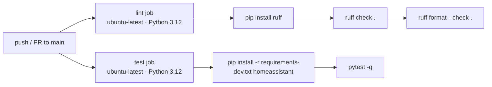

# Repository, CI and Roadmap

## Repository identity

| Field | Value |
|---|---|
| GitHub repo | `github.com/edhases/gemini-live-assistant` (from `manifest.json`) |
| Codeowner | `@edhases` |
| Issue tracker | `github.com/edhases/gemini-live-assistant/issues` |
| License | MIT, copyright © 2026 edhases |
| Integration version | `0.1.0` |
| HACS | Custom repository; `hacs.json` present |
| Distribution layout | `custom_components/gemini_live_assistant/` |

### `manifest.json`

```json
{
  "domain": "gemini_live_assistant",
  "name": "Gemini Live Assistant",
  "codeowners": ["@edhases"],
  "config_flow": true,
  "after_dependencies": ["assist_pipeline", "intent"],
  "dependencies": ["conversation"],
  "documentation": "https://github.com/edhases/gemini-live-assistant",
  "issue_tracker": "https://github.com/edhases/gemini-live-assistant/issues",
  "integration_type": "service",
  "iot_class": "cloud_polling",
  "requirements": ["google-genai==2.25.0"],
  "version": "0.1.0"
}
```

Notes:

- `dependencies: ["conversation"]` guarantees the conversation platform exists before setup.
- `after_dependencies` loads `assist_pipeline` and `intent` first when present, without requiring
  them.
- `integration_type: service` and `iot_class: cloud_polling` are metadata for HACS/HA; the
  integration performs no polling.
- `requirements` is pinned exactly. HACS/HA installs that version into the HA environment.
- `version` must be bumped for every release; HACS uses it to detect updates.

### `hacs.json`

```json
{
  "name": "Gemini Live Assistant",
  "render_readme": true,
  "homeassistant": "2024.1.0"
}
```

`homeassistant` is the declared minimum, but the code needs `ConfigEntry.runtime_data` and the
streaming conversation helpers, so it is **inaccurate** for this version. See
[00-overview.md](00-overview.md#supported-home-assistant-versions).

### Other repository files

| File | Purpose |
|---|---|
| `pyproject.toml` | Project metadata (version, Python ≥3.11), Ruff config, pytest config |
| `requirements.txt` | Runtime pin (`google-genai==2.25.0`) — mirrors `manifest.json` |
| `requirements-dev.txt` | `pytest`, `pytest-asyncio`, `pytest-cov`, `ruff` |
| `LICENSE` | MIT |
| `README.md` | User-facing install/usage summary |
| `.gitignore` | Python, test, secret, IDE and HA storage exclusions |
| `.github/workflows/ci.yml` | Lint and test jobs |
| `custom_components/.../strings.json` + `translations/` | UI strings (en, uk) |
| `tests/` | Unit tests (see [07-testing.md](07-testing.md)) |

**Not present:** `CONTRIBUTING.md`, `SECURITY.md`, issue/PR templates, `CODEOWNERS` file,
Dependabot config, release workflow, `hassfest`/HACS validation workflow, `tests/__init__.py`,
`pytest-homeassistant-custom-component`.

## CI

`.github/workflows/ci.yml` runs on pushes and pull requests to `main`:



| Job | Steps | Current state |
|---|---|---|
| `lint` | `ruff check .`, `ruff format --check .` | Passes as of this writing |
| `test` | install dev deps + unpinned `homeassistant`, run `pytest -q` | 16 tests; runs independently of `lint` |

Observations:

- `homeassistant` is unpinned in CI, so the test job tracks whatever is current stable. That is
  useful for compatibility signals but makes CI non-reproducible and can break without a code
  change.
- There is no caching, matrix, coverage upload or artifact step.
- No `hassfest` validation, no HACS action, no `mypy`/`pyright`, no secret scanning.
- Both jobs use Python 3.12 while `pyproject.toml` claims `>=3.11`. 3.11 is not exercised.

### Reproducing CI locally

```powershell
cd "E:\Github\Home Assistant\gemini-live-assistant"
python -m pip install -r requirements-dev.txt homeassistant
ruff check .
ruff format --check .
pytest -q
```

## Conventions

These are the conventions the codebase actually follows; the project-management ones are
recommendations.

### Code

- **Python 3.11+ syntax**, `from __future__ import annotations` at the top of every module.
- **Ruff** is the only formatter/linter: line length 100, rules `E,F,I,B,UP,SIM,RUF`, `E501`
  ignored. Run `ruff format` before committing.
- **Platform layout mirrors HA core**: `async_setup_entry` per platform, `AddEntitiesCallback`,
  `_attr_*` class attributes, `entry.runtime_data`.
- **Options merging** is always `{**entry.data, **entry.options}`.
- **Constants** live in `const.py`; no magic strings in platforms.
- **Logging** uses the module/package logger (`LOGGER` from `const.py`, or a local
  `logging.getLogger(__name__)` in `config_flow.py`). No `print`.
- **Errors** surfaced to users are `HomeAssistantError` with short, non-technical text; details go
  to the log.
- **Docstrings** on public classes/functions; comments only where the code is non-obvious (schema
  quirks, HA/ChatLog contracts).
- **Type hints** everywhere, including `AsyncGenerator` and `ContentDict` unions.
- **No new runtime dependencies** without a `manifest.json` + `requirements.txt` update and a
  review of HA's dependency constraints.

### Commits and branches

Recommended (not enforced by tooling):

- Branch from `main`: `feat/...`, `fix/...`, `docs/...`, `chore/...`.
- [Conventional Commits](https://www.conventionalcommits.org/) style:
  `feat(stt): add language hint`, `fix(entity): keep tool result order`.
- Keep PRs focused; include a test or a manual-test note.
- Never commit `.storage`, logs, keys or screenshots containing keys/entity data.

### Pull request checklist

- [ ] `ruff check .` passes.
- [ ] `ruff format --check .` passes.
- [ ] `pytest -q` passes (or new tests explain why not).
- [ ] `manifest.json` and `requirements.txt` agree on `google-genai`.
- [ ] Version bumped if behaviour changes (release PRs only).
- [ ] Docs updated under `docs/` when behaviour/options change.
- [ ] No secrets, tokens, personal entity names or household data.
- [ ] Manual test performed in a real HA instance for UI/platform changes.

## Releases

There is **no automated release workflow**. The process is manual:

1. Ensure `main` is green (`ruff`, `pytest`).
2. Decide the version (SemVer): `MAJOR.MINOR.PATCH`.
3. Update **both**:
   - `custom_components/gemini_live_assistant/manifest.json` → `"version"`
   - `pyproject.toml` → `[project].version`
4. Update `README.md` if features/options changed.
5. Commit: `chore(release): vX.Y.Z`.
6. Tag and push:

   ```powershell
   git tag -a v0.1.0 -m "v0.1.0"
   git push origin main --tags
   ```

7. Create a GitHub Release from the tag. HACS reads `manifest.json`; the release notes are for
   humans. Include breaking changes, new options and known issues.
8. Verify HACS shows the new version (may take a few minutes / a manual "Update information").

### Version policy

| Change | Bump |
|---|---|
| New feature, new option, new platform | MINOR |
| Bug fix, docs, internal refactor | PATCH |
| Breaking option/config-entry change, removed feature | MAJOR |
| Experimental Live work | Pre-release suffix (`0.3.0-beta.1`) |

Config-entry `VERSION` is `1` and there is no migration code. Any change to the stored schema
requires a `config_flow` migration step (`async_migrate_entry`) and a MAJOR/MINOR bump.

## Roadmap

The project's own README describes a three-step progression: text conversation → STT/TTS voice →
realtime Live voice. Below is the concrete state of each phase.

### Phase 1 — Text conversation + Home control ✅ (0.1.0)

- [x] Config flow with API-key validation.
- [x] Options flow (model, prompt, LLM API, temperature, max tokens).
- [x] Conversation entity with streaming.
- [x] HA tool conversion and manual function-calling loop.
- [x] Device control through `llm.LLM_API_ASSIST`.
- [x] Multi-API selection.
- [x] Unit tests for constants, config-flow shape and Live helpers.

### Phase 2 — Voice via STT/TTS ✅ (0.1.0)

- [x] STT entity using Gemini audio understanding (WAV/OGG, 16-bit, mono, 16–48 kHz).
- [x] TTS entity using Gemini TTS with prebuilt voices (WAV out, 24 kHz).
- [x] Configurable STT/TTS models and TTS voice.
- [x] Works in a standard Assist pipeline.
- [ ] Per-call STT prompt / vocabulary hints (planned).
- [ ] Language-aware TTS (`language_code`) (planned).
- [ ] Advertise supported TTS voices to the UI (planned).
- [ ] Streaming TTS playback (planned).

### Phase 3 — Realtime Live voice 🚧 (experimental, unwired)

- [x] `live.py` client: connect, audio in/out, text turns, transcripts, tool calls,
      turn-complete/interruption flags.
- [x] Unit tests for config building and event normalisation.
- [ ] HA tool → Live tool bridge (planned).
- [ ] Live tool execution through HA (planned).
- [ ] Session manager with lifecycle/reconnect (planned).
- [ ] Audio transport (browser card or satellite firmware) (planned).
- [ ] Entity/service/websocket API (planned).
- [ ] Barge-in, echo cancellation, VAD tuning (planned).
- [ ] Cost/session limits (planned).

### Phase 4 — Hardening and HA quality scale 📋 (planned)

- [ ] Pin `homeassistant` in CI (or add a supported-version matrix).
- [ ] Add `pytest-homeassistant-custom-component`; test setup/unload, config flow, conversation,
      STT and TTS.
- [ ] Register an options update listener → reload entry.
- [ ] Reauth flow; allow key rotation without deleting the entry.
- [ ] Diagnostics platform with redaction.
- [ ] Replace the key-suffix `unique_id` with a salted hash.
- [ ] Correct `hacs.json` minimum HA version (or add compatibility).
- [ ] Fix `iot_class` (`cloud_polling` → a more accurate value).
- [ ] Remove or use `TIMEOUT_MILLIS` and `DEFAULT_TITLE`.
- [ ] `hassfest` + HACS validation + secret scanning + Dependabot in CI.
- [ ] `SECURITY.md`, `CONTRIBUTING.md`, issue/PR templates.
- [ ] Broader UI translations.

### Phase 5 — Product polish 📋 (planned)

- [ ] Prompt presets and a prompt-editing helper.
- [ ] Per-tool/domain allow-lists in options.
- [ ] Conversation debugging panel (tool calls, latency, token usage).
- [ ] Announcement/TTS caching.
- [ ] Optional local fallback for non-cloud-critical intents.
- [ ] Documentation site / screenshots.

## Known issues and backlog

Concrete findings from the current code, ordered by impact. None of these are fixed as part of
this documentation task.

| # | Issue | Impact | Suggested fix |
|---|---|---|---|
| 1 | CI installs an unpinned `homeassistant` | Non-reproducible; CI can break without a code change | Pin a version or add a supported-version matrix |
| 2 | `hacs.json` minimum `2024.1.0` is lower than the code supports | Install failures on old HA | Bump to the real minimum or add shims |
| 3 | No options update listener | STT/TTS model/voice changes need a manual reload | `entry.add_update_listener` → `async_reload` |
| 4 | `enable_live`/`live_model`/`live_voice` are inert | Users expect behaviour that does not exist | Hide behind "experimental" or wire `live.py` |
| 5 | `unique_id` exposes 8 key characters | Minor secret fingerprinting | Store a salted hash instead |
| 6 | No reauth flow; key cannot be edited | Rotation requires delete/re-add | Add `async_step_reauth` and key update |
| 7 | No tests for `entity.py`, `stt.py`, `tts.py`, `conversation.py` | Regressions in the core path | Add mocked unit tests, then HA harness tests |
| 8 | `TIMEOUT_MILLIS` defined but unused | Dead config; no explicit timeout | Apply via SDK/http options or remove |
| 9 | `DEFAULT_TITLE` defined but unused | Dead constant | Use it in the flow or remove |
| 10 | `iot_class: cloud_polling` inaccurate | Misleading metadata | Use a truthful value |
| 11 | Generic `ERROR_GETTING_RESPONSE` for all API failures | Poor UX for quota/auth errors | Map common status codes to specific messages |
| 12 | STT model selector reuses `CHAT_MODELS` | Unclear UI, but functionally intentional | Rename the list or add an `STT_MODELS` alias |
| 13 | STT fallback labels un-converted non-PCM audio as WAV | Would fail/hallucinate on unusual formats | Only advertise/convert supported formats; raise otherwise |
| 14 | TTS reads `parts[0]` only | Could truncate multi-part audio | Concatenate all inline audio parts |
| 15 | TTS does not advertise voices (`async_get_supported_voices`) | Voice cannot be chosen per pipeline/UI | Implement the property |
| 16 | Entity name translations in `strings.json` are unused | Dead translation keys | Add `translation_key` or remove |
| 17 | `cannot_connect` is used for unexpected validation errors | Hides programming errors as network errors | Add an `unknown` mapping |
| 18 | `_escape_decode` can raise on malformed escape sequences | Tool arg crash | Guard with `try/except` and fall back to the raw value |
| 19 | Live normaliser overwrites repeated parts | Dropped audio/text chunks | Emit one event per part or accumulate |
| 20 | No CI cache, coverage upload, hassfest validation or secret scan | Slow and shallow checks | Extend the workflow |

## How to contribute

1. Open an issue describing the problem (no secrets, no personal data).
2. Fork, branch from `main`, make a focused change.
3. Add/update tests under `tests/`.
4. Run `ruff check .`, `ruff format --check .`, `pytest -q`.
5. Update `docs/` and `README.md` if behaviour or options changed.
6. Open a PR using the checklist above; reference the issue.

For security-sensitive reports, do not open a public issue — contact the codeowner privately
(`@edhases` on GitHub) until a `SECURITY.md` policy exists.
